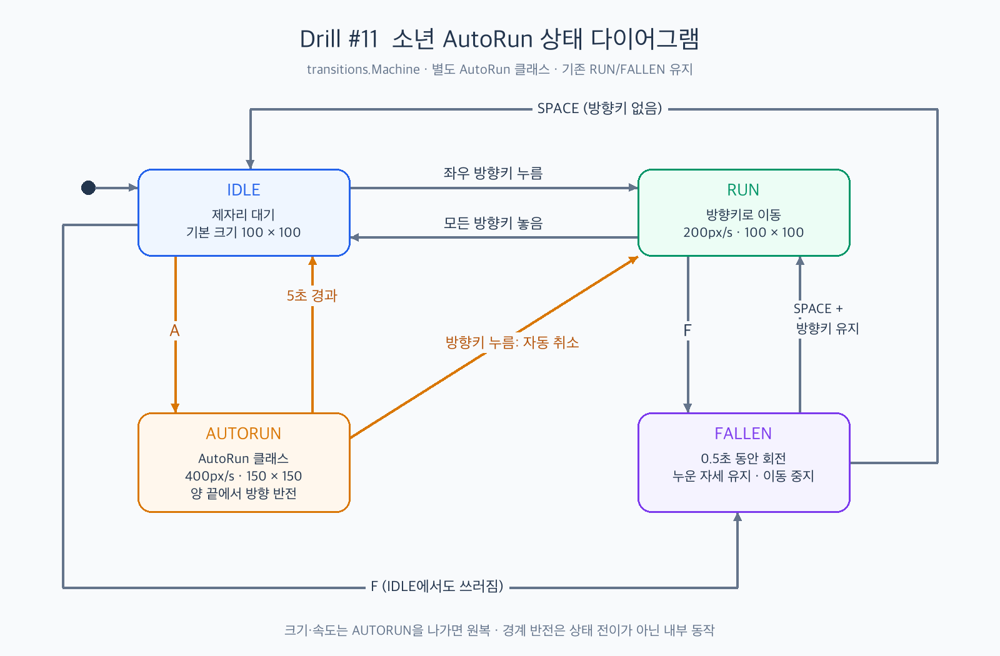

# Drill #11 — 소년 AutoRun

`transitions` 상태 머신에 별도의 `AutoRun` 클래스로 자동 달리기를 구현했습니다.

## 구현 내용

- IDLE에서 **A**를 누르면 키 조작 없이 자동으로 달립니다.
- 일반 RUN보다 속도는 **2배**, 크기는 **1.5배** 커집니다.
- 화면의 좌우 끝에서 자동으로 방향을 바꿉니다.
- **5초**가 지나면 IDLE로 돌아갑니다.
- 자동 달리기 중 **← / →**를 누르면 해당 방향의 일반 RUN으로 전환합니다.
- 기존 방향키 이동과 **F**로 쓰러지기, **SPACE**로 일어나기를 유지했습니다.

## 실행

```bash
python -m pip install -r requirements.txt
python boy_game.py
```

기획 및 요구사항: [PRD.md](PRD.md)


