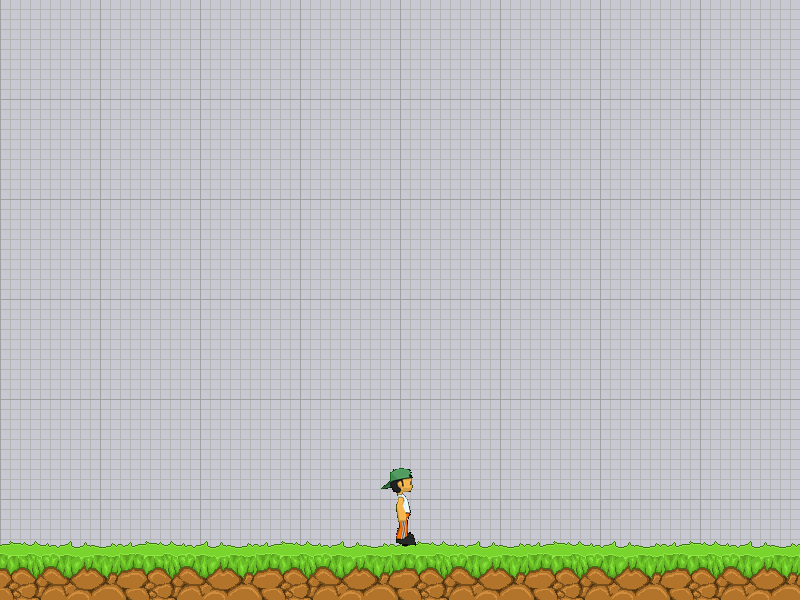
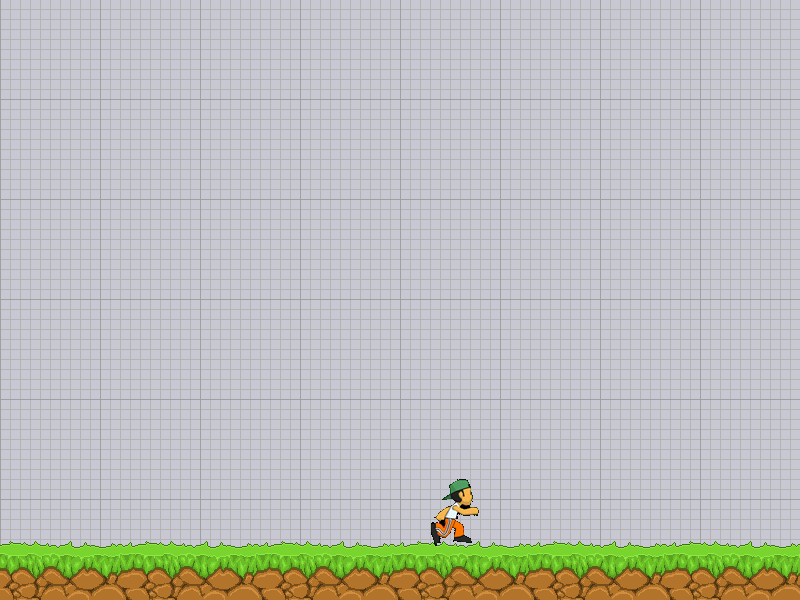
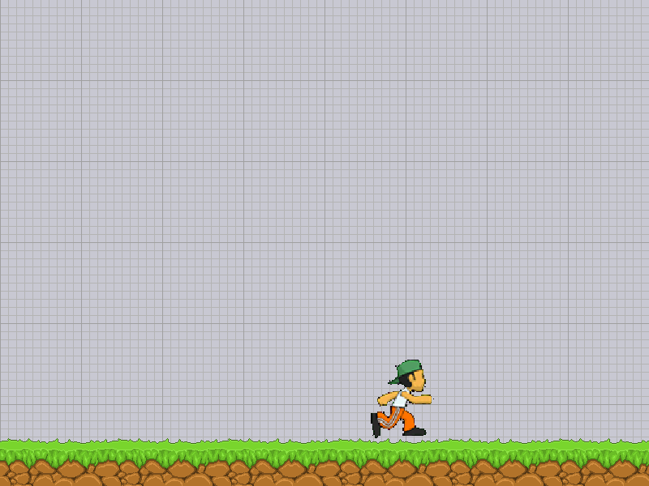
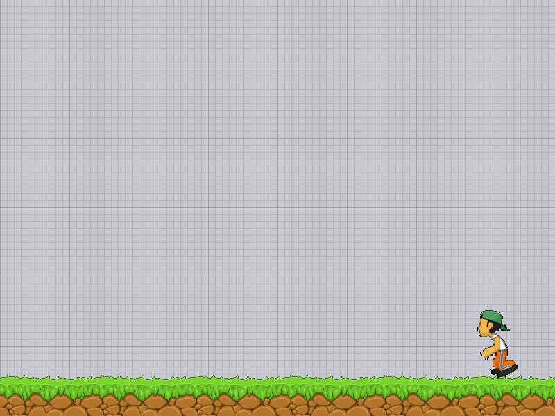
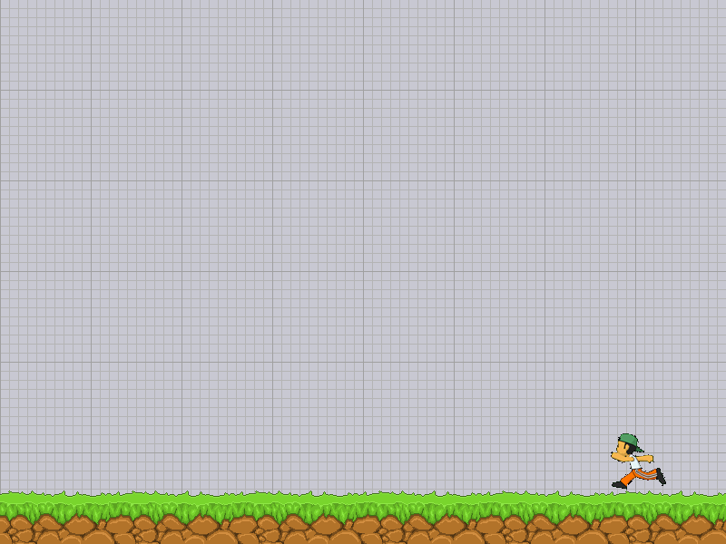
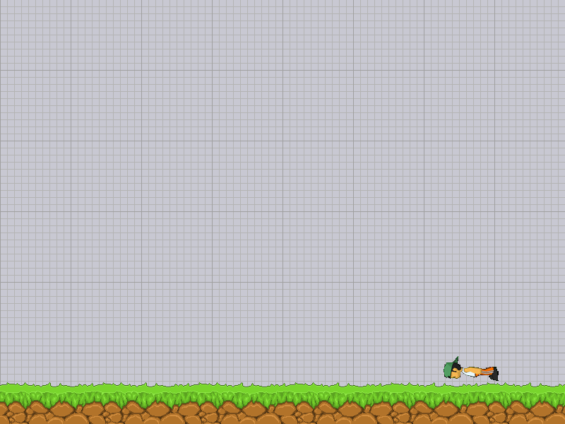
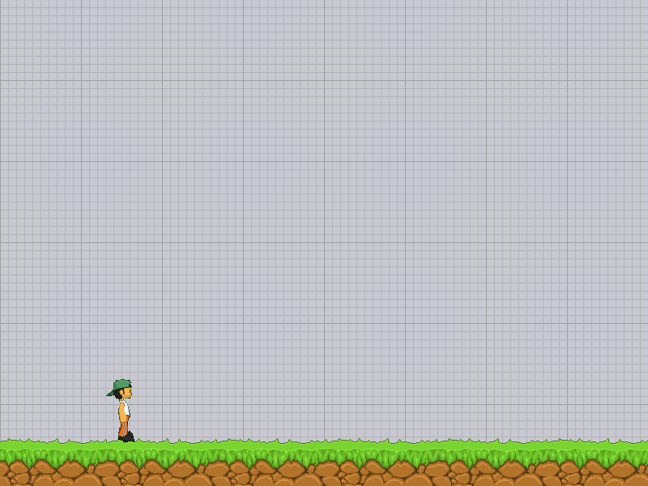

# 실행 검증 기록

검증일: 2026-10-27 (한국 시간)

## 요구사항 자동 검증

`python -m unittest discover -s tests -v`

18개 테스트 통과. 다음을 확인했다.

- 별도 `AutoRun` 클래스와 네 상태의 명시적 전이
- A 입력 후 키를 놓아도 이동, 반복 A가 제한 시간을 연장하지 않음
- 일반 RUN 대비 속도 2배, 실제 그리기 인자 150×150
- 4.999초까지 유지, 5초 시점 IDLE 복귀, 재진입 시 타이머 초기화
- 좌·우 경계 반사와 확대 크기 경계, 왼쪽 이동 방향 유지
- 큰 시간 간격과 작은 시간 간격에서 반사 후 위치·방향 일치
- 방향키 취소 후 일반 속도·기본 크기·입력 방향 복구
- 양쪽 방향키 우선순위, 일반 이동 경계, 기존 FALLEN·SPACE 복귀

## 실제 이미지와 SDL 이벤트 경로 검증

저장소 외부 작업 경로에서 다음을 실행했다.

```bash
SDL_VIDEODRIVER=dummy python /저장소경로/tools/render_smoke_test.py --output /임시경로
```

Python 3.9, pico2d 1.5.1, transitions 0.9.3 환경에서 실행했다.
SDL 소프트웨어 렌더러를 사용해 실제 PNG 리소스를 읽고 화면에 그렸다.
SDL 이벤트 큐에 키 누름·놓음·종료 이벤트를 넣어 `get_events()`부터 게임 처리까지 검증했다.
시간은 재현 가능한 시나리오를 위해 제어했다. 사람이 직접 누르는 키보드 테스트는 아니다.

검증 스크립트는 BMP 화면을 저장하며, 아래 PNG는 해당 실행 화면을 변환한 파일이다.
변환은 제출용 기록 작업이며 게임 실행에는 추가 이미지 처리 패키지가 필요 없다.

### 기본 대기와 일반 달리기




### 자동 달리기와 경계 방향 전환




### 취소·쓰러짐·시간 만료 복귀





## 수동 재현 순서

1. `python boy_game.py`로 실행하고 게임 창을 클릭한다.
2. A를 한 번 눌렀다 놓는다. 소년이 커지고 빠르게 이동하는지 확인한다.
3. 조작 없이 양 끝에서 반사하고 5초 뒤 멈추는지 확인한다.
4. 다시 A를 누르고 ← 또는 →를 누른다. 즉시 크기·속도가 원복되고 해당 방향으로 달려야 한다.
5. 방향키를 떼어 멈춘 뒤 F로 쓰러지고 SPACE로 복귀한다.
6. ESC 또는 창 닫기로 종료한다.
